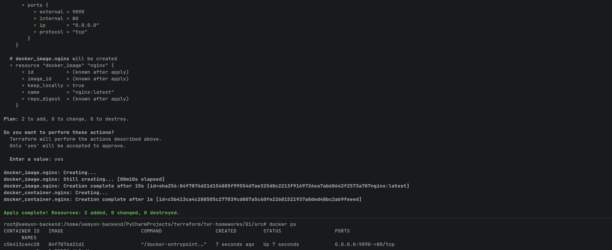

2. Изучите файл **.gitignore**. В каком terraform-файле, согласно этому .gitignore, допустимо сохранить личную, секретную информацию?(логины,пароли,ключи,токены итд)
- в файле игнор есть наименование файла personal.auto.tfvars , там и можно хранит переменные, креды и т.п.

3. Выполните код проекта. Найдите  в state-файле секретное содержимое созданного ресурса **random_password**, пришлите в качестве ответа конкретный ключ и его значение.
Высылаю скрин подтверждения создания пароля


4. Раскомментируйте блок кода, примерно расположенный на строчках 29–42 файла **main.tf**.
Выполните команду ```terraform validate```. Объясните, в чём заключаются намеренно допущенные ошибки. Исправьте их.

Ответ: Ошибки заключаются в том, что:
- для ресурсов всегда требуется указывать две метки, а в данном случае была указана одна
- ошибка в синтаксие образа 1nginx
- на скрине нету, увидел позже, не правильное использование переменных в блоке docker_container, random_string_FAKE.resulT

5. Выполните код. В качестве ответа приложите: исправленный фрагмент кода и вывод команды ```docker ps```.

- создал контейнер через terraform

