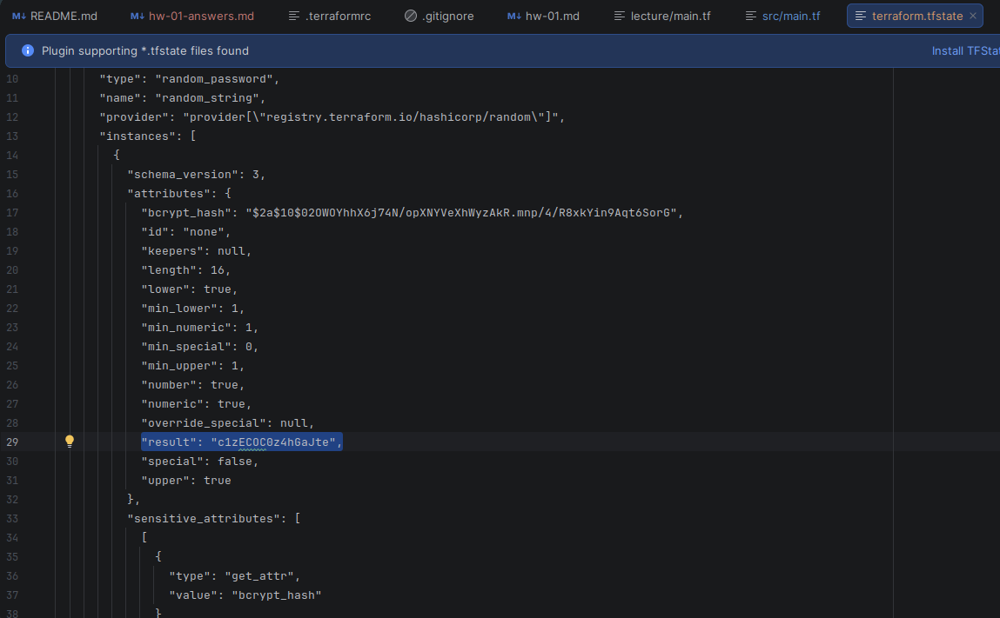
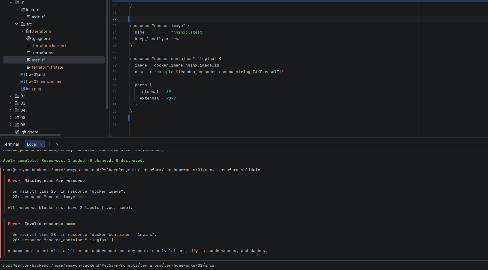
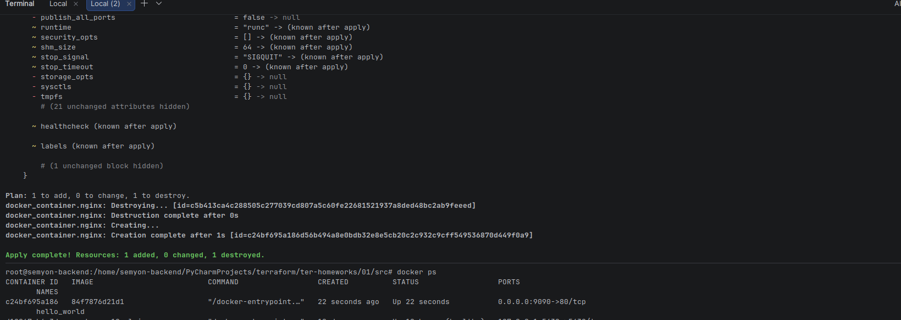
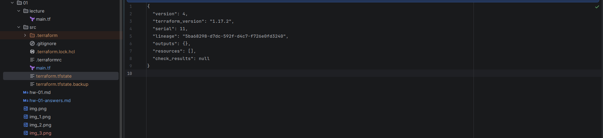

2. Изучите файл **.gitignore**. В каком terraform-файле, согласно этому .gitignore, допустимо сохранить личную, секретную информацию?(логины,пароли,ключи,токены итд)
- в файле игнор есть наименование файла personal.auto.tfvars , там и можно хранит переменные, креды и т.п.

3. Выполните код проекта. Найдите  в state-файле секретное содержимое созданного ресурса **random_password**, пришлите в качестве ответа конкретный ключ и его значение.
Высылаю скрин подтверждения создания пароля


4. Раскомментируйте блок кода, примерно расположенный на строчках 29–42 файла **main.tf**.
Выполните команду ```terraform validate```. Объясните, в чём заключаются намеренно допущенные ошибки. Исправьте их.

Ответ: Ошибки заключаются в том, что:
- для ресурсов всегда требуется указывать две метки, а в данном случае была указана одна
- ошибка в синтаксие образа 1nginx
- на скрине нету, увидел позже, не правильное использование переменных в блоке docker_container, random_string_FAKE.resulT

5. Выполните код. В качестве ответа приложите: исправленный фрагмент кода и вывод команды ```docker ps```.

- создал контейнер через terraform

6. Замените имя docker-контейнера в блоке кода на ```hello_world```. Не перепутайте имя контейнера и имя образа. Мы всё ещё продолжаем использовать name = "nginx:latest". Выполните команду ```terraform apply -auto-approve```.
Объясните своими словами, в чём может быть опасность применения ключа  ```-auto-approve```. Догадайтесь или нагуглите зачем может пригодиться данный ключ? В качестве ответа дополнительно приложите вывод команды ```docker ps```.

Мои предположения следующие: учитывая тот момент, что мы разворачиваем что-то через  CI/CD в гитлаб или другом месте, то в CI/CD для развертки нужен сквозной проход без оставноки, и флаг этот может как раз обеспечить запуск через
тригеры в CI/CD или около того. А если не поставим флаг, то стейдж CI/CD просто остановиться и упадет. Проблема заключается в том, что без контроля ресурсов, терраформ может изменить конфигурацию или удалить то, что не нужно удалять.

8. Уничтожьте созданные ресурсы с помощью **terraform**. Убедитесь, что все ресурсы удалены. Приложите содержимое файла **terraform.tfstate**. 

Удалил ресурсы через terraform destroy

9. Объясните, почему при этом не был удалён docker-образ **nginx:latest**. Ответ **ОБЯЗАТЕЛЬНО НАЙДИТЕ В ПРЕДОСТАВЛЕННОМ КОДЕ**, а затем **ОБЯЗАТЕЛЬНО ПОДКРЕПИТЕ** строчкой из документации [**terraform провайдера docker**](https://library.tf/providers/kreuzwerker/docker/latest).  (ищите в классификаторе resource docker_image )
Провайдер не удалил образ по причине того, что в tf конфигурации развертки стоял флаг keep_locally=true, данный флаг как раз не удаляет образ из докера. Подтверждается вырезкой: keep_locally (Boolean) If true, then the Docker image won't be deleted on destroy operation.